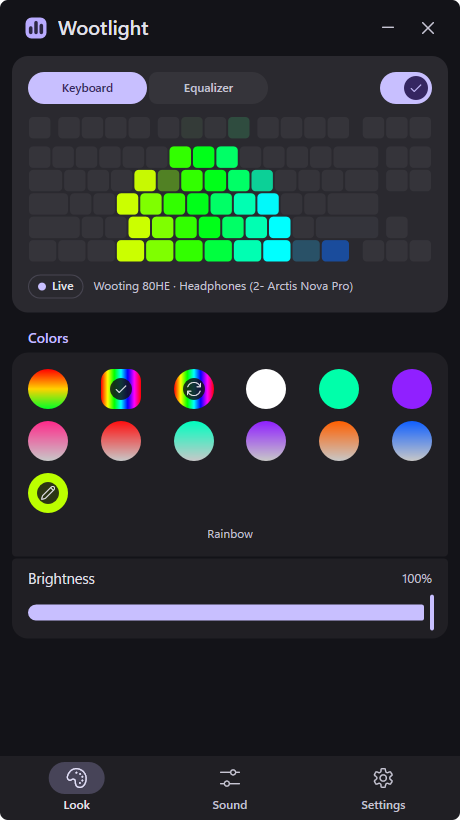
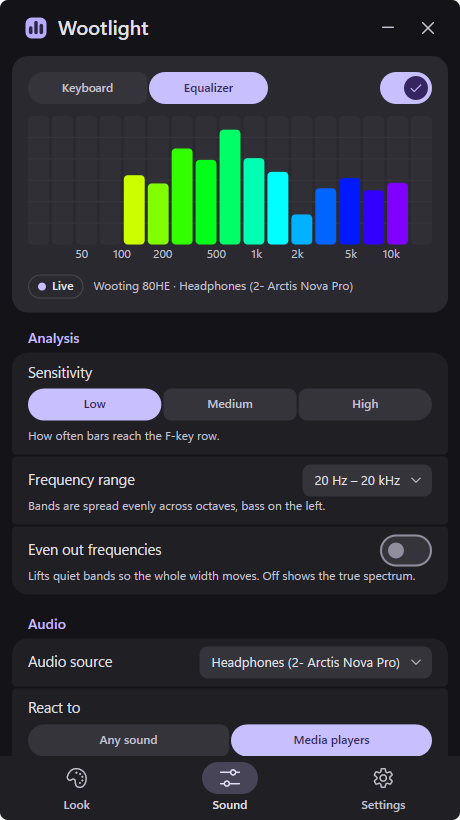
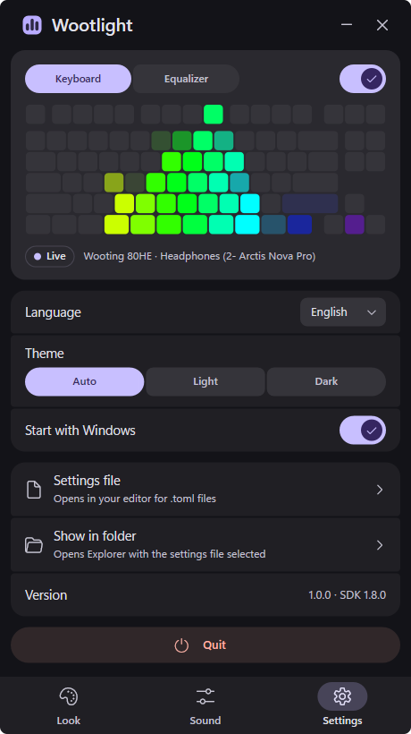

<p align="center">
  
</p>

<h1 align="center">Wootlight</h1>

<p align="center">
  A music spectrum visualizer for the lighting of Wooting keyboards: whatever plays on your PC
  becomes equalizer bars across your keys.
</p>

<p align="center">
  English · <a href="README.uk.md">Українська</a>
</p>

<p align="center">
  Wootlight is free and open source. If you'd like to say thanks, you can support it on
  <a href="https://ko-fi.com/swiftlyx">Ko-fi</a> or through a <a href="https://send.monobank.ua/jar/8C2ACvGoty">monobank jar</a>. Entirely optional:
  bug reports and tests on other Wooting models help just as much.
</p>

---

Wootlight listens to the sound your PC plays, splits it into frequency bands and lights every column
of keys as one bar: bass on the left, treble on the right, the louder the band the higher the bar.
The other keys stay dark. When the music stops, the keyboard goes back to its own lighting, the
profile you set up in Wootility, and Wootlight takes over again as soon as sound returns.

It is a single native executable that lives in the tray. There is no installer and no driver. Your
settings are kept in a file next to the executable. Running in the tray it needs about 30 MB of
memory and around 1% of one CPU core or less. It also runs on Macs with Apple Silicon, in the menu
bar, thanks to [Jason Bryner](https://github.com/jrbryner): see [macOS](#macos).

<p align="center">
  
  &nbsp;
  
  &nbsp;
  
</p>

## Contents

- [Features](#features) · [Supported keyboards](#supported-keyboards)
- [Getting started](#getting-started) · [Usage](#usage) · [Settings file](#settings-file)
- [How it works](#how-it-works) · [Building from source](#building-from-source) · [macOS](#macos) ·
  [Troubleshooting](#troubleshooting) · [Acknowledgements](#acknowledgements) · [License](#license)

## Features

- **Fits your keyboard.** Wootlight detects the model and lays the bars over its real key
  positions, ANSI or ISO. Wide keys such as Shift, Enter and Space light up with the average of the
  bars above them.
- **The whole range, evenly.** Bands are spread evenly over the octaves from 20 Hz to 20 kHz, so
  bass, mids and treble each get their share of the width. *Even out frequencies* lifts quiet bands
  such as deep bass and the air above 13 kHz, so the whole keyboard moves.
- **Colors.** Twelve presets: Classic, Rainbow, Flowing rainbow, solid white, turquoise and
  purple, and gradients from white to pink, red, turquoise, purple, orange and blue. Make your own
  solid color or gradient and save up to 11 of them as presets.
- **Music only, if you like.** With *React to: Media players*, Wootlight listens only to the player
  that shows playback in the Windows media controls: YouTube Music, Spotify, a video in your
  browser. Voice chat in Discord, games and system sounds stay off the keyboard.
- **Your lighting when silent.** After a few seconds of silence the keyboard shows its own profile
  until sound comes back. When Wootlight quits, the profile comes back too.
- **Effects while it is quiet.** Nine animations for the time no music plays: rain, a
  thunderstorm, the Matrix, snow, a starry sky, an aurora, ripples, fire and a snake that plays
  itself or that you steer with the arrow keys. None of them runs the same way twice. They
  start after a while without keyboard or mouse input and stop when you are back or when the
  keyboard would dim, or they run whenever no music plays. In their own colors, the visualizer's,
  or yours.
- **A live view.** The window shows the keyboard exactly as it is lit, or a plain equalizer of the
  same bands with a frequency scale, so you can see how the two compare. It draws at your monitor's
  refresh rate.
- **Small and quiet.** One executable, portable settings, *Start with Windows* without
  administrator rights. English and Ukrainian, light and dark themes.
- **Up to date by itself.** Wootlight checks GitHub for new versions and installs them while you
  are away. All settings back up to one file and restore from it.

## Supported keyboards

| Model | Bars | Rows |
|---|---|---|
| Wooting One | 18 | 6 |
| Wooting Two, Two Lekker, Two HE | 22 | 6 |
| Wooting 60HE and its variants | 15 | 5 (no function row) |
| Wooting UwU | 7 | 5 |
| Wooting 80HE | 17 | 6 |

Wootlight has been tested by hand on the 80HE; the layouts of the other models are covered by
tests. If you own one of them, a screenshot or a photo in an
[issue](https://github.com/Swiftlyx/Wootlight/issues) helps a lot. A model Wootlight does not
know yet still works, as a plain grid.

## Getting started

1. Download `Wootlight.exe` from the [latest release](https://github.com/Swiftlyx/Wootlight/releases/latest).
2. Put it in a folder you can write to, for example `Documents\Wootlight`. Wootlight keeps its
   settings in `Wootlight.toml` next to the executable.
3. Run it. Windows SmartScreen may warn about an unknown publisher, because the executable is not
   signed: choose *More info* → *Run anyway*.

Requirements: Windows 10 or 11 (64-bit) and a Wooting keyboard. Wootility does not need to run.
For a Mac, see [macOS](#macos).

## Usage

Wootlight lives in the tray. Its icon is a keycap with equalizer bars in the color of your scheme:
tall bars while music plays, low bars in silence, an outline while the visualizer is paused.

- **Left click** the icon to open or hide the window.
- **Right click** for the menu: open the window, turn the visualizer on or off, *Start with
  Windows*, quit.
- Starting `Wootlight.exe` again opens the window of the copy that is already running.

At the top of the window is the live view, with the *Keyboard | Equalizer* switch and the main on/off
switch. Below it are four pages:

- **Look**: the color presets, your own color (*Solid* or *Gradient*, set by hue and saturation),
  *Save as preset*, and brightness. Pick a saved preset to adjust it with the sliders or delete it.
- **Sound**: sensitivity (how often the bars reach the top row), the frequency range (20 Hz – 5 kHz,
  30 Hz – 10 kHz, 40 Hz – 16 kHz or 20 Hz – 20 kHz), *Even out frequencies*, the audio source,
  *React to: Any sound | Media players*, and *Your lighting when silent*.
- **Effects**: the animation for the time no music plays, *Show: When idle | Always*, how long to
  wait (*Start after*, 30 seconds to an hour), and its colors: *Natural*, *Visualizer* (the colors
  of *Look*) or *Custom*. While this page is open, the effect runs all the time, whether you use the
  keyboard or not, so you can see it.
- **Settings**: language, theme, *Start with Windows*, updates, the settings file, *Show in folder*,
  *Back up settings* and *Restore settings*, the log.

The window works from the keyboard too: Tab and Shift+Tab move the focus, Enter or Space presses,
← and → move a slider, Esc closes a list or hides the window.

*Back up settings* saves every setting (colors, saved presets, sound, effects) to a file you choose;
*Restore settings* loads one back and checks first that it is a Wootlight settings file. *Start
with Windows* is not part of the file.

With *Get updates: Automatic*, Wootlight asks GitHub for the latest release half a minute after it
starts and every 6 hours. A new `Wootlight.exe` is downloaded next to the running one, checked
against the release's `SHA256SUMS.txt`, and swapped in while nobody uses the computer and no music
plays, or at the next start; *Update to … and restart* does it at once. *Notify* only shows the new
version, and *Off* never contacts GitHub. The check sends nothing but the request itself.

*Start with Windows* creates a Task Scheduler task, *Wootlight*, that starts the app when you sign
in. It needs no administrator rights, and moving `Wootlight.exe` to another folder updates the task
on the next start.

## Settings file

`Wootlight.toml` sits next to `Wootlight.exe`. *Settings → Settings file* opens it in your editor for
`.toml` files, and changes apply as soon as you save. Each setting has a comment in the interface
language.

| Key | Default | Meaning |
|---|---|---|
| `enabled` | `true` | Visualizer on; `false` gives the lighting back to the keyboard. |
| `language` | `"en"` | `"en"` or `"uk"`. |
| `theme` | `"auto"` | `"auto"`, `"light"` or `"dark"`. |
| `color` | `"classic"` | `"classic"`, `"rainbow"`, `"flow"`, one color like `"#00ffaa"`, or bottom to top like `"#c8c8c8>#ff2a8a"`. |
| `custom_color` | `"#c8c8c8>#ffb000"` | Your own color, used by *Custom*. |
| `saved_colors` | `[]` | Saved custom presets, up to 11, in the same format. |
| `brightness` | `1.0` | 0.0 – 1.0. |
| `range_db` | `30.0` | dB from the bottom row to the top row (6 – 90): lower is more contrast. |
| `headroom_db` | `3.0` | How far below the top row the loudest band sits on average (0 – half of `range_db`). |
| `floor_db` | `-75.0` | Level in dBFS treated as silence (-120 – -20). |
| `tilt_db` | `2.0` | Treble boost per octave around 1 kHz (-6 – 6). |
| `equalize` | `1.0` | How strongly quiet bands are lifted (0 – 1); 0 shows the true spectrum. |
| `fmin`, `fmax` | `20.0`, `20000.0` | Frequency range in Hz. |
| `fps` | `120.0` | Analysis rate while the window is closed (30 – 360); with the window open it follows the monitor. |
| `hue_speed` | `0.08` | Turns per second of *Flowing rainbow*. |
| `audio_device` | `""` | Part of the name of the output device to show; empty follows the Windows default. |
| `media_only` | `false` | Listen only to the player that shows playback in the Windows media controls. |
| `release_when_silent` | `true` | Show the keyboard's own lighting while nothing plays. |
| `release_after_sec` | `3.0` | Seconds of silence before that (0.5 – 600). |
| `effect` | `"off"` | Animation while no music plays: `"rain"`, `"storm"`, `"matrix"`, `"snow"`, `"stars"`, `"aurora"`, `"ripples"`, `"fire"`, `"snake"` or `"off"`. |
| `effect_when` | `"idle"` | `"idle"`: after `effect_after_sec` without keyboard or mouse input; `"always"`: whenever no music plays. |
| `effect_after_sec` | `60.0` | Seconds without input before the effect starts (10 – 3600). |
| `effect_color` | `"natural"` | `"natural"`, `"scheme"` (the visualizer's color) or `"custom"`. |
| `effect_custom_color` | `"#1060ff>#ffffff"` | Your own effect color: one color, or base to highlight like `"#1060ff>#ffffff"`. |
| `snake_play` | `false` | The arrow keys steer the snake and do not stop the effect. |
| `updates` | `"auto"` | `"auto"`, `"notify"` or `"off"`. |

The *Low*, *Medium* and *High* sensitivity presets are pairs of `range_db` and `headroom_db`.

Other files:

| What | Where |
|---|---|
| Settings | `Wootlight.toml` next to `Wootlight.exe` |
| Log, kept across starts; past 1 MB it moves to `wootlight.old.log` | `%LOCALAPPDATA%\Wootlight\wootlight.log` |
| Wooting RGB SDK, unpacked on start | `%LOCALAPPDATA%\Wootlight\wooting-rgb-sdk64.dll` |
| Start with Windows | Task Scheduler, task *Wootlight* |
| A downloaded update, until it is installed | `Wootlight.update-<version>.exe` next to `Wootlight.exe` |

If the folder of the executable cannot be written to, such as Program Files, the settings go to
`%APPDATA%\Wootlight\Wootlight.toml` instead.

Command line: `--open` opens the window right after the start; `--stats` writes the frame rate,
the audio level and how often the top row lights up to the log every 5 seconds.

## How it works

1. **Capture.** Wootlight records what goes to the output device through WASAPI loopback. It does
   not touch the sound itself.
2. **Spectrum.** An FFT splits the sound into bands of equal musical width: each band is the same
   fraction of an octave. Bass bands use a longer window, so 20, 30 and 45 Hz stay apart.
3. **Level.** Each band's level in dB is compared with a slow average of the loudest band.
   Sensitivity sets how far above that average the top row is. *Even out frequencies* pulls each
   band's average over the last ~4 seconds towards a common level, by up to 30 dB. Bands more than
   50 dB below the loudest one, or digital silence, stay dark.
4. **Motion.** Bars rise almost at once and fall smoothly.
5. **Keys.** The keyboard is divided into strips of equal physical width, one bar each. A key belongs
   to the strip its center falls in; wide keys take the average of the strips they cover. Each row is
   one step of height, so the tops of neighbouring bars line up, and only a full bar reaches the top
   row.
6. **Lighting.** Frames go to the keyboard through the Wooting RGB SDK. A full frame takes about
   16 ms over USB, so the keyboard updates up to about 62 times a second: that is the limit of the
   hardware. The window draws at the monitor's refresh rate and stops drawing while hidden or
   minimized.

*React to: Media players* asks the Windows media controls which player is playing, finds its
process among the apps that make sound, and records that process alone (process loopback, Windows
10 version 2004 or later). The status line under the live view then names the player instead of
the device. A browser counts as one app, so all of its tabs are heard together. If Wootlight
cannot tell which process plays, it listens to the whole device while the player plays.

*Effects* never show over music. *When idle*, an effect starts once the keyboard and the mouse
have rested for *Start after*; Wootlight asks Windows only how long ago the last input was, never
which keys were pressed. It stops at the next input, and when the keyboard's *Dim After* from
Wootility passes, so the keyboard still dims as you set it up; Wootlight reads that time from the
keyboard when it connects. *Always* shows the effect instead of your profile whenever no music
plays, and the keyboard does not dim meanwhile.

Every run of an effect draws its own parameters, and slow drifts change them as it goes: showers
come and go, each with its own wind, and the rain slows down a little now and then; storms strike
near or far; every stream of the Matrix speeds up and slows down on its own; snow falls in flurries,
piles up to half the keyboard's height and melts back a row; the shooting stars, short or long,
faint or bright, fly level, slant a row or two, or fall straight down; the aurora and the ripples
take new shapes and rhythms.

The snake plays itself: it heads for the food by a short path, takes only moves after which it can
still reach its tail, and strays from the shortest way by a taste for detours drawn for every game.
It starts slow and speeds up, and the faster it goes, the more it slips, so it loses now and then.
With *Play with the arrow keys* the arrows steer it, and they do not stop the effect: Wootlight
then reads the state of the four arrow keys while the snake runs, nothing else. Left alone for a
few seconds, the snake plays on its own again.

## Building from source

You need a recent stable [Rust](https://rustup.rs) with the MSVC toolchain and the Visual Studio
Build Tools. The Windows SDK's `rc.exe` embeds the icon and the version information; without it the
build still works, without them.

```bat
git clone https://github.com/Swiftlyx/Wootlight
cd Wootlight
cargo test
cargo build --release
```

The result is `target\release\Wootlight.exe`. The
[Wooting RGB SDK v1.8.0](https://github.com/WootingKb/wooting-rgb-sdk/releases/tag/v1.8.0) is in
`vendor\` and is built into the executable. A `wooting-rgb-sdk64.dll` next to the executable takes
its place.

One test creates and deletes a Task Scheduler task named *Wootlight.Test*.

## macOS

Wootlight also runs on Macs with Apple Silicon and macOS 14.4 or later;
[Jason Bryner](https://github.com/jrbryner) ported it.

Releases from 1.3.0 on include `Wootlight-<version>-macos-arm64.zip`, built on GitHub Actions. Unzip
it, move `Wootlight.app` to *Applications* and open it. The app is not notarized by Apple, so macOS
blocks the first start: open *System Settings → Privacy & Security* and choose *Open Anyway* next to
Wootlight, or run `xattr -dr com.apple.quarantine /Applications/Wootlight.app` once in Terminal.

To build it yourself, you need [Rust](https://rustup.rs) and the Xcode command line tools
(`xcode-select --install`).

```sh
git clone https://github.com/Swiftlyx/Wootlight
cd Wootlight
cargo test
scripts/bundle-macos.sh
```

The result is `target/Wootlight.app`: move it to *Applications* and open it. The Wooting RGB SDK
built for arm64 is in `vendor/macos/` and goes into the app; `scripts/build-wooting-sdk-macos.sh`
builds it again from the SDK's v1.8.0 source, as the release build does.

On the Mac, Wootlight works the same, with these differences:

- **Menu bar.** Wootlight lives in the menu bar, with a monochrome mark and no Dock icon. Click the
  mark to open or hide the window; right click or Control-click for the menu. Closing the window
  leaves the app running.
- **Permission.** The first time Wootlight listens, macOS asks to allow *System Audio Recording*.
  Without it the bars stay still: allow Wootlight in *System Settings → Privacy & Security → Screen &
  System Audio Recording*. The sound is analyzed live and is never recorded or sent anywhere. It is
  captured through Core Audio process taps instead of WASAPI loopback.
- **Media players.** *React to: Media players* follows *Now Playing* in Control Center and records
  the playing app's sound alone. Only the app that macOS shows there counts. Since macOS 15.4 Now
  Playing answers only Apple's own programs, so Wootlight asks it through the system's `perl`: you
  may see a `perl` process while it runs. If that stops working, Wootlight listens to the whole
  device.
- **Open at Login** takes the place of *Start with Windows*. It adds Wootlight to *System Settings →
  General → Login Items*, and macOS may ask you to approve it there.
- **Lighting.** The keyboard gets up to about 30 frames a second, because a constant stream of frames
  makes it lag on keystrokes on macOS. Wootlight opens the keyboard shared, so Wootility still
  reaches it.
- **Files.** Settings, the log and the unpacked SDK are in `~/Library/Application Support/Wootlight`,
  not next to the app, because the app bundle is signed.
- **Updates.** Wootlight tells when a new version is out, and *Download* opens its page; it does not
  replace the app by itself yet.

## Troubleshooting

- **The keyboard does not light up.** Close other apps that control RGB lighting, such as OpenRGB
  or SignalRGB: only one app can drive the keyboard at a time. Check the status line under the live
  view: it shows the keyboard and the audio device Wootlight uses.
- **The bars do not move.** Check *Sound → Audio source*. With *React to: Media players* the
  keyboard waits for a player in the Windows media controls; switch to *Any sound* to see every
  sound.
- **The bars are dimmer than usual.** Wootility's *Dim After* dims the keyboard when you have not
  typed for a while. If it dimmed before the music started, the keyboard keeps that brightness under
  Wootlight too, until you press any key. Wootlight cannot lift it: the firmware takes no command
  for that. Press a key (a media key on the keyboard to start the music works too), set *Dim After*
  to a longer time or turn it off. While Wootlight drives the lighting, the keyboard does not dim.
- **The effect never starts when idle.** *Start after* has to be shorter than *Dim After* in
  Wootility: the page says when it is not. Music, or any sound with *React to: Any sound*, also
  keeps it away.
- **The bars rarely reach the top, or always sit there.** Change the sensitivity, or turn *Even out
  frequencies* on or off.
- **It did not start with Windows.** Check that the *Wootlight* task exists in Task Scheduler and
  points at your `Wootlight.exe`. Turning *Start with Windows* off and on recreates it.
- **It stops now and then, or something else.** Open *Settings → Log*. Each line has the time and
  says what happened: when the lighting went back to the keyboard and why (no player playing, the
  player silent, no sound from the device), which player and keyboard Wootlight found, a part of the
  app that got stuck, and where it crashed. Please attach the log to an
  [issue](https://github.com/Swiftlyx/Wootlight/issues).

## Acknowledgements

- [Jason Bryner](https://github.com/jrbryner) ported Wootlight to macOS: the sound capture, Now
  Playing, the menu bar, the window, Open at Login and the SDK build for Apple Silicon.
- [Wooting RGB SDK](https://github.com/WootingKb/wooting-rgb-sdk) drives the keyboard lighting.
- The LED positions were checked against the Wooting matrix maps of
  [OpenRGB](https://gitlab.com/CalcProgrammer1/OpenRGB).
- The interface follows [Material 3 Expressive](https://m3.material.io/) by Google.
- Now Playing on macOS is read through the system's `perl`, a way found by
  [mediaremote-adapter](https://github.com/ungive/mediaremote-adapter).

Wootlight is not affiliated with or endorsed by Wooting. Wooting is a trademark of its owner.

## License

[MIT](LICENSE). Third-party code and its licenses are listed in
[THIRD_PARTY_NOTICES.md](THIRD_PARTY_NOTICES.md).
