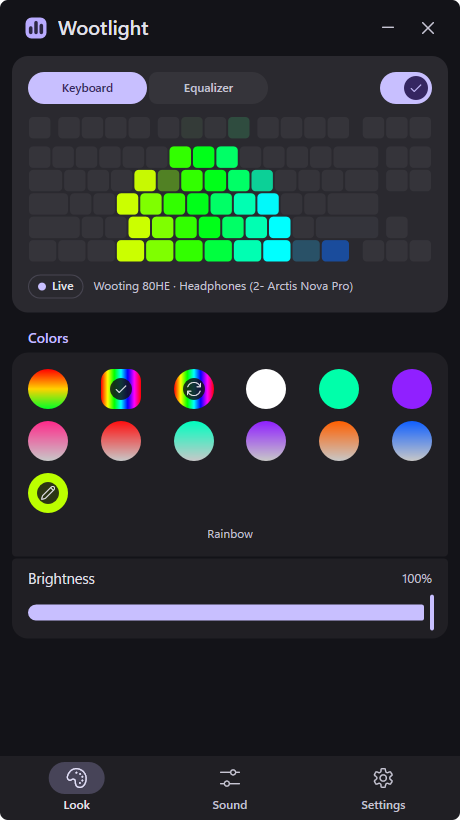
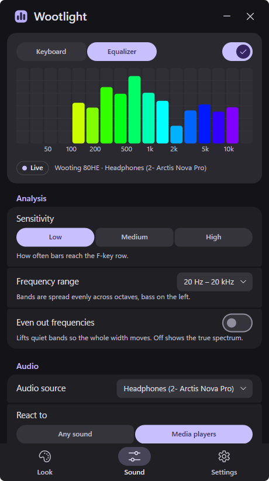
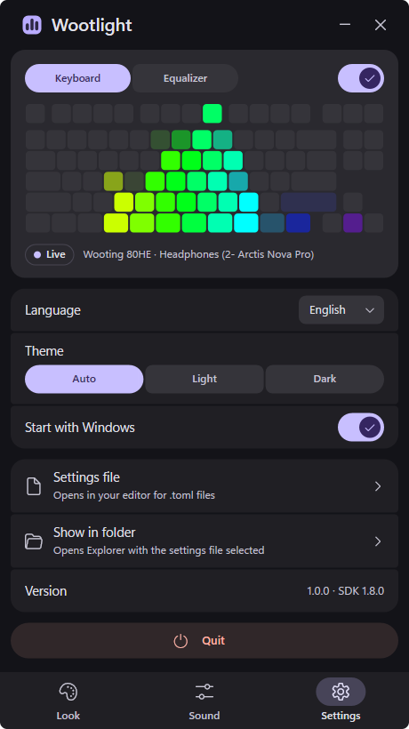

<p align="center">
  
</p>

<h1 align="center">Wootlight</h1>

<p align="center">
  Музичний візуалізатор спектра на підсвітці клавіатур Wooting: усе, що грає на комп'ютері,
  перетворюється на стовпчики еквалайзера на ваших клавішах.
</p>

<p align="center">
  <a href="README.md">English</a> · Українська
</p>

<p align="center">
  Wootlight безкоштовний і з відкритим кодом. Якщо хочеться подякувати, підтримати можна через
  <a href="https://ko-fi.com/swiftlyx">Ko-fi</a> або <a href="https://send.monobank.ua/jar/8C2ACvGoty">банку monobank</a>. Це повністю за бажанням:
  звіти про помилки й тести на інших моделях Wooting допомагають не менше.
</p>

---

Wootlight слухає звук, який грає комп'ютер, розкладає його на частотні смуги й світить кожну
колонку клавіш як один стовпчик: бас ліворуч, високі праворуч, що гучніша смуга, то вищий
стовпчик. Решта клавіш темні. Коли музика стихає, клавіатура повертається до власної підсвітки,
тобто профілю з Wootility, а щойно звук повертається, Wootlight знову бере підсвітку на себе.

Це один нативний exe, що живе в треї. Ні інсталятора, ні драйверів. Налаштування лежать у файлі
поруч з exe. У треї програмі потрібно близько 30 МБ пам'яті й близько 1% одного ядра процесора або
менше. Завдяки [Jason Bryner](https://github.com/jrbryner) він працює й на Mac з Apple Silicon, у
рядку меню: див. [macOS](#macos).

<p align="center">
  
  &nbsp;
  
  &nbsp;
  
</p>

## Зміст

- [Можливості](#можливості) · [Підтримувані клавіатури](#підтримувані-клавіатури)
- [Початок роботи](#початок-роботи) · [Користування](#користування) · [Файл налаштувань](#файл-налаштувань)
- [Як це працює](#як-це-працює) · [Збірка з коду](#збірка-з-коду) · [macOS](#macos) ·
  [Якщо щось не так](#якщо-щось-не-так) · [Подяки](#подяки) · [Ліцензія](#ліцензія)

## Можливості

- **Під вашу клавіатуру.** Wootlight визначає модель і накладає стовпчики на справжнє
  розташування клавіш, ANSI чи ISO. Широкі клавіші, як-от Shift, Enter і пробіл, світяться
  середнім стовпчиків над ними.
- **Увесь діапазон, рівномірно.** Смуги розподілені рівно за октавами від 20 Гц до 20 кГц, тож
  бас, середина й високі отримують свою частку ширини. *Вирівнювати частоти* піднімає тихі
  смуги, як-от глибокий бас і «повітря» вище 13 кГц, щоб рухалася вся клавіатура.
- **Кольори.** Дванадцять пресетів: класичний, веселка, веселка, що пливе, суцільні білий,
  бірюзовий і фіолетовий, і переходи з білого в рожевий, червоний, бірюзовий, фіолетовий,
  помаранчевий і синій. Створіть свій суцільний колір чи перехід і збережіть до 11 таких пресетів.
- **Лише музика, якщо хочете.** З *Реагувати на: Медіаплеєри* Wootlight слухає лише плеєр, який
  показує відтворення в медіаелементах Windows: YouTube Music, Spotify, відео в браузері. Голос у
  Discord, ігри та системні звуки на клавіатуру не потрапляють.
- **Ваша підсвітка в тиші.** Після кількох секунд тиші клавіатура показує свій профіль, доки не
  повернеться звук. Коли Wootlight закривається, профіль теж повертається.
- **Живий перегляд.** Вікно показує клавіатуру саме так, як вона світиться, або звичайний
  еквалайзер тих самих смуг зі шкалою частот, щоб їх можна було порівняти. Кадри йдуть із частотою
  оновлення монітора.
- **Маленька й тиха.** Один exe, портативні налаштування, запуск з Windows без прав адміністратора.
  Англійська й українська мови, світла й темна теми.

## Підтримувані клавіатури

| Модель | Стовпчиків | Рядів |
|---|---|---|
| Wooting One | 18 | 6 |
| Wooting Two, Two Lekker, Two HE | 22 | 6 |
| Wooting 60HE і варіанти | 15 | 5 (без ряду F) |
| Wooting UwU | 7 | 5 |
| Wooting 80HE | 17 | 6 |

Наживо Wootlight перевірено на 80HE, розкладки інших моделей покриті тестами. Якщо у вас одна з
них, скриншот або фото в [issue](https://github.com/Swiftlyx/Wootlight/issues) дуже допоможе.
Модель, якої Wootlight ще не знає, теж працює, простою сіткою.

## Початок роботи

1. Завантажте `Wootlight.exe` з [останнього релізу](https://github.com/Swiftlyx/Wootlight/releases/latest).
2. Покладіть його в папку, куди можна писати, наприклад `Documents\Wootlight`. Налаштування
   зберігаються в `Wootlight.toml` поруч з exe.
3. Запустіть. Windows SmartScreen може попередити про невідомого видавця, бо exe не підписаний:
   натисніть *Докладніше* → *Усе одно запустити*.

Потрібні Windows 10 або 11 (64-біт) і клавіатура Wooting. Запускати Wootility не потрібно.
Для Mac див. [macOS](#macos).

## Користування

Wootlight живе в треї. Його значок — кейкап зі стовпчиками еквалайзера в кольорі вашої схеми:
високі стовпчики, коли грає музика, низькі в тиші, лише контур, коли візуалізатор на паузі.

- **Лівий клік** по значку відкриває або ховає вікно.
- **Правий клік** — меню: відкрити вікно, увімкнути чи вимкнути візуалізатор, запуск з Windows,
  вийти.
- Повторний запуск `Wootlight.exe` відкриває вікно вже запущеної копії.

Угорі вікна — живий перегляд з перемикачем *Клавіатура | Еквалайзер* і головним перемикачем.
Нижче три сторінки:

- **Вигляд**: пресети кольорів, свій колір (*Суцільна* чи *Перехід*, задається відтінком і
  насиченістю), *Зберегти як пресет* і яскравість. Вибраний збережений пресет можна підправити
  повзунками або видалити.
- **Звук**: чутливість (як часто стовпчики доходять до верхнього ряду), діапазон частот
  (20 Гц – 5 кГц, 30 Гц – 10 кГц, 40 Гц – 16 кГц або 20 Гц – 20 кГц), *Вирівнювати частоти*,
  джерело звуку, *Реагувати на: Будь-який звук | Медіаплеєри* і *Ваша підсвітка в тиші*.
- **Налаштування**: мова, тема, запуск з Windows, файл налаштувань, *Показати в папці*.

Вікном можна керувати й з клавіатури: Tab і Shift+Tab переводять фокус, Enter або пробіл
натискають, ← і → рухають повзунок, Esc закриває список або ховає вікно.

*Запускати з Windows* створює в Планувальнику завдань задачу *Wootlight*, яка запускає програму
при вході в систему. Прав адміністратора не потрібно, а якщо перенести `Wootlight.exe` в іншу
папку, задача оновиться під час наступного запуску.

## Файл налаштувань

`Wootlight.toml` лежить поруч з `Wootlight.exe`. *Налаштування → Файл налаштувань* відкриває його в
редакторі для файлів `.toml`, а зміни застосовуються одразу після збереження. Кожне налаштування має
коментар мовою інтерфейсу.

| Ключ | За замовчуванням | Що робить |
|---|---|---|
| `enabled` | `true` | Візуалізатор увімкнено; `false` повертає підсвітку клавіатурі. |
| `language` | `"en"` | `"en"` або `"uk"`. |
| `theme` | `"auto"` | `"auto"`, `"light"` або `"dark"`. |
| `color` | `"classic"` | `"classic"`, `"rainbow"`, `"flow"`, один колір, як-от `"#00ffaa"`, або знизу вгору, як-от `"#c8c8c8>#ff2a8a"`. |
| `custom_color` | `"#c8c8c8>#ffb000"` | Ваш колір для пункту «Свій». |
| `saved_colors` | `[]` | Збережені свої пресети, до 11, у тому ж форматі. |
| `brightness` | `1.0` | 0.0 – 1.0. |
| `range_db` | `30.0` | дБ від нижнього ряду до верхнього (6 – 90): менше — контрастніше. |
| `headroom_db` | `3.0` | Наскільки нижче верхнього ряду в середньому стоїть найгучніша смуга (0 – половина `range_db`). |
| `floor_db` | `-75.0` | Рівень у dBFS, що вважається тишею (-120 – -20). |
| `tilt_db` | `2.0` | Підсилення високих частот на октаву відносно 1 кГц (-6 – 6). |
| `equalize` | `1.0` | Наскільки сильно піднімати тихі смуги (0 – 1); 0 — чесний спектр. |
| `fmin`, `fmax` | `20.0`, `20000.0` | Діапазон частот, Гц. |
| `fps` | `120.0` | Частота аналізу, поки вікно закрите (30 – 360); з відкритим вікном дорівнює частоті монітора. |
| `hue_speed` | `0.08` | Обертів за секунду для «Веселки, що пливе». |
| `audio_device` | `""` | Частина назви пристрою виводу; порожньо — пристрій Windows за замовчуванням. |
| `media_only` | `false` | Слухати лише плеєр, який показує відтворення в медіаелементах Windows. |
| `release_when_silent` | `true` | Показувати власну підсвітку клавіатури, коли нічого не грає. |
| `release_after_sec` | `3.0` | Скільки секунд тиші чекати перед цим (0.5 – 600). |

Пресети чутливості *Низька*, *Середня* і *Висока* — це пари значень `range_db` і `headroom_db`.

Інші файли:

| Що | Де |
|---|---|
| Налаштування | `Wootlight.toml` поруч з `Wootlight.exe` |
| Журнал, зберігається між запусками; понад 1 МБ переходить у `wootlight.old.log` | `%LOCALAPPDATA%\Wootlight\wootlight.log` |
| Wooting RGB SDK, розпаковується при запуску | `%LOCALAPPDATA%\Wootlight\wooting-rgb-sdk64.dll` |
| Запуск з Windows | Планувальник завдань, задача *Wootlight* |

Якщо в папку з exe не можна писати, як-от у Program Files, налаштування зберігаються в
`%APPDATA%\Wootlight\Wootlight.toml`.

Командний рядок: `--open` відкриває вікно одразу після старту; `--stats` кожні 5 секунд пише в
журнал частоту кадрів, рівень звуку й те, як часто світиться верхній ряд.

## Як це працює

1. **Звук.** Wootlight записує те, що йде на пристрій виводу, через WASAPI loopback. Сам звук він
   не змінює.
2. **Спектр.** FFT розкладає звук на смуги однакової музичної ширини: кожна смуга — та сама частка
   октави. Для басу вікно довше, щоб 20, 30 і 45 Гц не зливалися.
3. **Рівень.** Рівень кожної смуги в дБ порівнюється з повільним середнім найгучнішої смуги.
   Чутливість задає, наскільки вище цього середнього верхній ряд. *Вирівнювати частоти* підтягує
   середній рівень кожної смуги за останні ~4 секунди до спільного, до 30 дБ. Смуги, тихіші за
   найгучнішу більш ніж на 50 дБ, і цифрова тиша лишаються темними.
4. **Рух.** Стовпчики піднімаються майже миттєво й плавно опускаються.
5. **Клавіші.** Клавіатура ділиться на смуги однакової фізичної ширини, по одній на стовпчик.
   Клавіша належить смузі, на яку припадає її центр; широкі клавіші беруть середнє смуг, які
   накривають. Кожен ряд — один крок висоти, тож верхівки сусідніх стовпчиків вирівняні, а до
   верхнього ряду доходить лише повний стовпчик.
6. **Підсвітка.** Кадри йдуть на клавіатуру через Wooting RGB SDK. Повний кадр передається через
   USB приблизно за 16 мс, тож клавіатура оновлюється до ~62 разів на секунду: це межа апаратури.
   Вікно малює з частотою монітора й не малює, поки сховане або згорнуте.

*Реагувати на: Медіаплеєри* питає медіаелементи Windows, який плеєр грає, знаходить його процес
серед програм, що видають звук, і записує лише цей процес (process loopback, Windows 10 версії 2004
або новіша). Тоді в рядку стану під живим переглядом замість пристрою стоїть назва плеєра. Браузер
вважається однією програмою, тож усі його вкладки чутно разом. Якщо Wootlight не може визначити,
який процес грає, поки плеєр грає, він слухає весь пристрій.

## Збірка з коду

Потрібні свіжий стабільний [Rust](https://rustup.rs) з MSVC і Visual Studio Build Tools. `rc.exe` з
Windows SDK вшиває в exe іконку й відомості про версію; без нього збірка теж працює, лише без них.

```bat
git clone https://github.com/Swiftlyx/Wootlight
cd Wootlight
cargo test
cargo build --release
```

Результат — `target\release\Wootlight.exe`.
[Wooting RGB SDK v1.8.0](https://github.com/WootingKb/wooting-rgb-sdk/releases/tag/v1.8.0) лежить у
`vendor\` і вбудовується в exe. Якщо поруч з exe лежить `wooting-rgb-sdk64.dll`, використовується
вона.

Один тест створює й видаляє задачу Планувальника *Wootlight.Test*.

## macOS

Wootlight працює й на Mac з Apple Silicon і macOS 14.4 або новішою; портував його
[Jason Bryner](https://github.com/jrbryner). Готової збірки для Mac поки немає, тож програму
потрібно зібрати самому. Знадобляться [Rust](https://rustup.rs) і інструменти командного рядка
Xcode (`xcode-select --install`).

```sh
git clone https://github.com/Swiftlyx/Wootlight
cd Wootlight
cargo test
scripts/bundle-macos.sh
```

Результат — `target/Wootlight.app`: перенесіть його в *Програми* й відкрийте. Wooting RGB SDK,
зібраний для arm64, лежить у `vendor/macos/` і вбудовується в програму;
`scripts/build-wooting-sdk-macos.sh` збирає його наново з коду SDK v1.8.0.

На Mac Wootlight працює так само, з такими відмінностями:

- **Рядок меню.** Wootlight живе в рядку меню, з монохромним значком і без значка в Dock. Клік по
  значку відкриває або ховає вікно; правий клік або Control-клік — меню. Якщо закрити вікно,
  програма працює далі.
- **Дозвіл.** Коли Wootlight уперше починає слухати, macOS просить дозволити запис системного аудіо
  (*System Audio Recording*). Без нього стовпчики стоять: дозвольте Wootlight у *Системні параметри →
  Приватність і безпека → Запис екрана й системного аудіо* (англійською *System Settings → Privacy &
  Security → Screen & System Audio Recording*). Звук аналізується наживо, ніде не записується й
  нікуди не надсилається. Записується він через Core Audio process taps замість WASAPI loopback.
- **Медіаплеєри.** *Реагувати на: Медіаплеєри* стежить за «Зараз відтворюється» в Центрі керування
  й записує лише звук програми, що грає. Враховується тільки та програма, яку там показує macOS.
  Починаючи з macOS 15.4, «Зараз відтворюється» відповідає лише власним програмам Apple, тож
  Wootlight питає через системний `perl`: поки він працює, можна побачити процес `perl`. Якщо це
  перестане працювати, Wootlight слухає весь пристрій.
- **Відкривати під час входу** замінює запуск з Windows. Перемикач додає Wootlight у список *Login
  Items* (*Системні параметри → Загальні*), і macOS може попросити схвалити його там.
- **Підсвітка.** Клавіатура отримує до ~30 кадрів на секунду, бо безперервний потік кадрів на macOS
  змушує її запізнюватися з натисканнями. Wootlight відкриває клавіатуру спільно, тож Wootility теж
  має до неї доступ.
- **Файли.** Налаштування, журнал і розпакований SDK лежать у `~/Library/Application
  Support/Wootlight`, а не поруч із програмою, бо бандл програми підписаний.

## Якщо щось не так

- **Клавіатура не світиться.** Закрийте інші програми, що керують RGB-підсвіткою, як-от OpenRGB
  чи SignalRGB: керувати клавіатурою може лише одна програма. Подивіться рядок стану під живим
  переглядом: там видно клавіатуру й пристрій звуку, з якими працює Wootlight.
- **Стовпчики не рухаються.** Перевірте *Звук → Джерело звуку*. З *Реагувати на: Медіаплеєри*
  клавіатура чекає плеєр у медіаелементах Windows; перемкніть на *Будь-який звук*, щоб бачити все.
- **Стовпчики тьмяніші, ніж зазвичай.** *Dim After* у Wootility затемнює клавіатуру, якщо якийсь
  час нічого не друкувати. Якщо вона затемнилася ще до музики, то й під Wootlight лишається з цією
  яскравістю, доки ви не натиснете будь-яку клавішу. Wootlight зняти це не може: прошивка не приймає
  для цього жодної команди. Натисніть клавішу (підійде й медіаклавіша на клавіатурі, якою вмикаєте
  музику), поставте *Dim After* на довший час або вимкніть його. Поки підсвіткою керує Wootlight,
  клавіатура не затемнюється.
- **Стовпчики рідко доходять до верху або постійно там.** Змініть чутливість або ввімкніть чи
  вимкніть *Вирівнювати частоти*.
- **Не запустився з Windows.** Перевірте, що в Планувальнику завдань є задача *Wootlight* і вона
  вказує на ваш `Wootlight.exe`. Якщо вимкнути й увімкнути *Запускати з Windows*, вона створиться
  наново.
- **Час від часу перестає працювати, або щось інше.** Відкрийте *Налаштування → Журнал*. Кожен
  рядок має час і каже, що сталося: коли підсвітка повернулася клавіатурі й чому (жоден плеєр не
  грає, плеєр мовчить, із пристрою не йде звук), який плеєр і яку клавіатуру знайшов Wootlight,
  яка частина програми зависла і де вона впала. Додайте журнал до
  [issue](https://github.com/Swiftlyx/Wootlight/issues).

## Подяки

- [Jason Bryner](https://github.com/jrbryner) портував Wootlight на macOS: запис звуку, «Зараз
  відтворюється», рядок меню, вікно, відкриття під час входу й збірку SDK для Apple Silicon.
- [Wooting RGB SDK](https://github.com/WootingKb/wooting-rgb-sdk) керує підсвіткою клавіатури.
- Розташування світлодіодів звірено з картами Wooting в
  [OpenRGB](https://gitlab.com/CalcProgrammer1/OpenRGB).
- Інтерфейс побудований на [Material 3 Expressive](https://m3.material.io/) від Google.
- «Зараз відтворюється» на macOS читається через системний `perl` — цей спосіб знайшов
  [mediaremote-adapter](https://github.com/ungive/mediaremote-adapter).

Wootlight не пов'язаний з Wooting і не схвалений нею. Wooting — торгова марка її власника.

## Ліцензія

[MIT](LICENSE). Сторонній код і його ліцензії перелічені в
[THIRD_PARTY_NOTICES.md](THIRD_PARTY_NOTICES.md).
